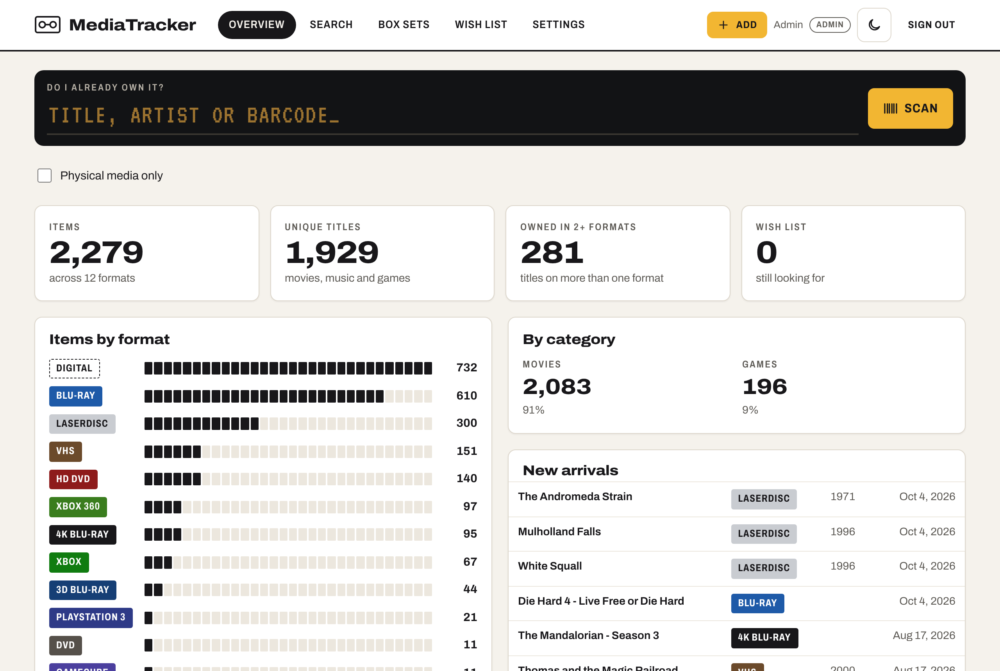
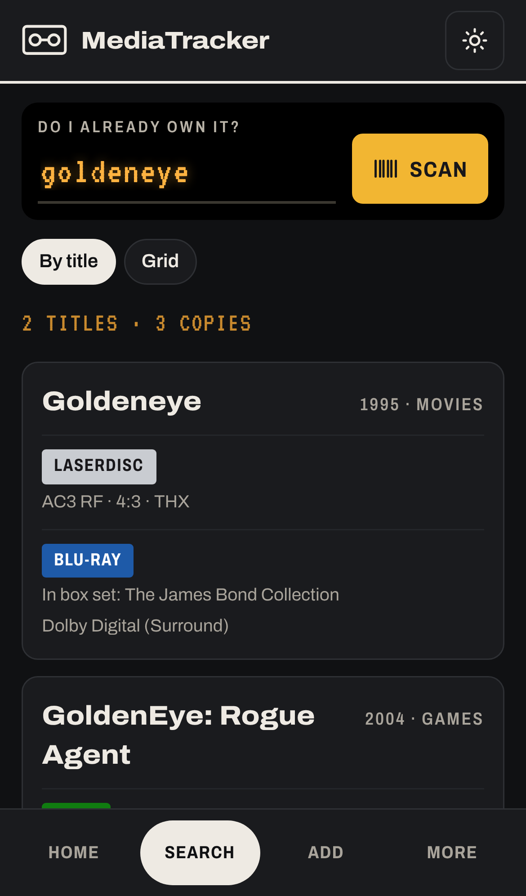
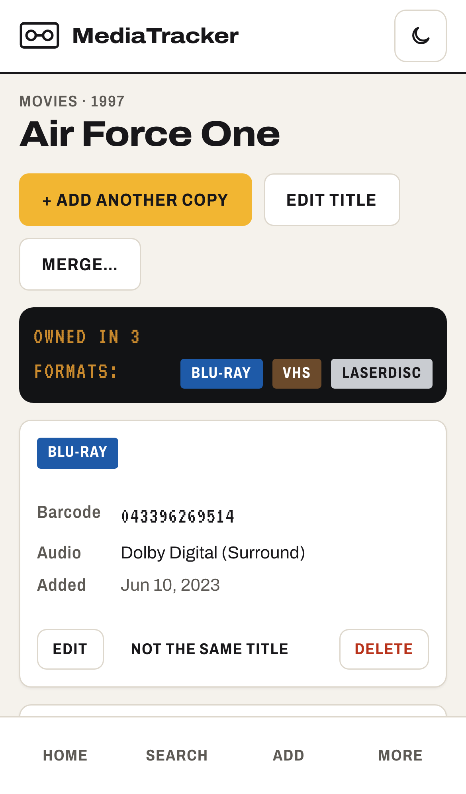
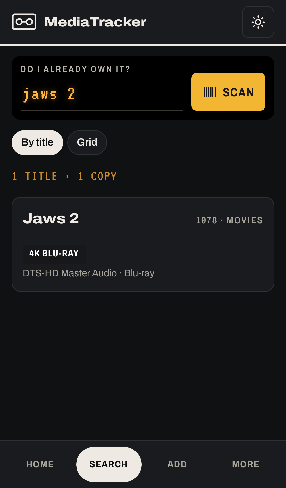
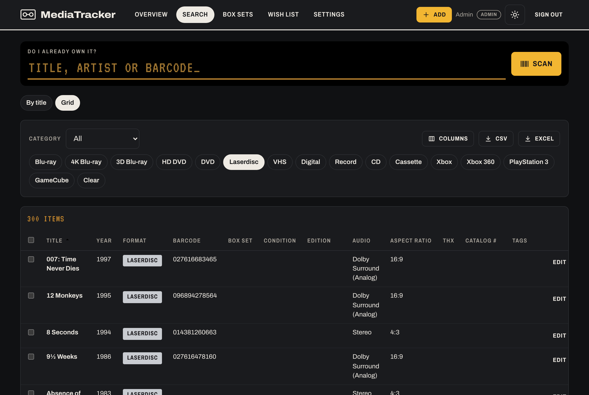
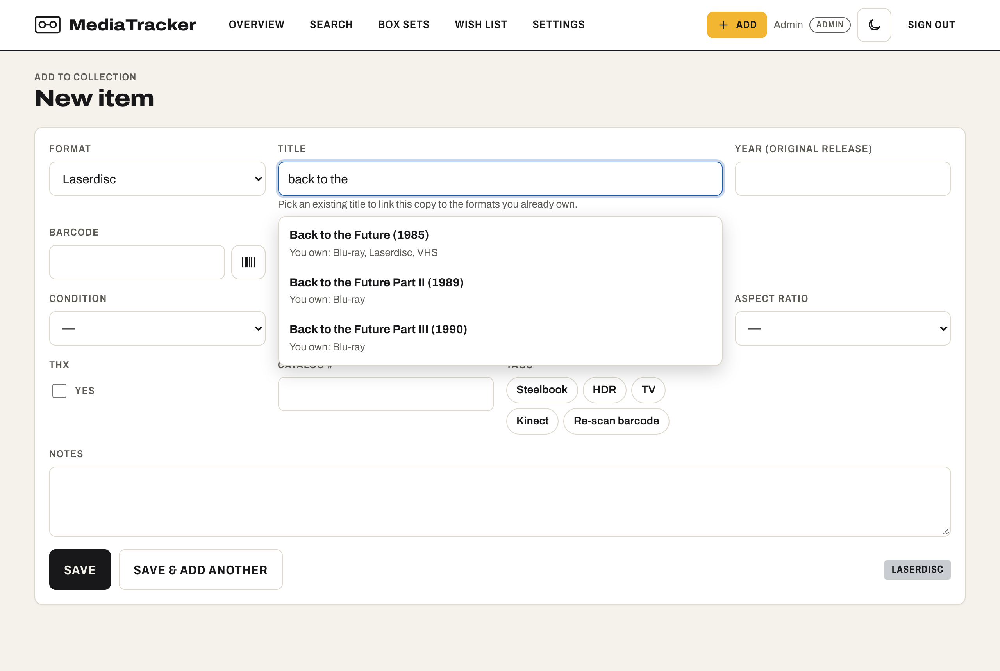
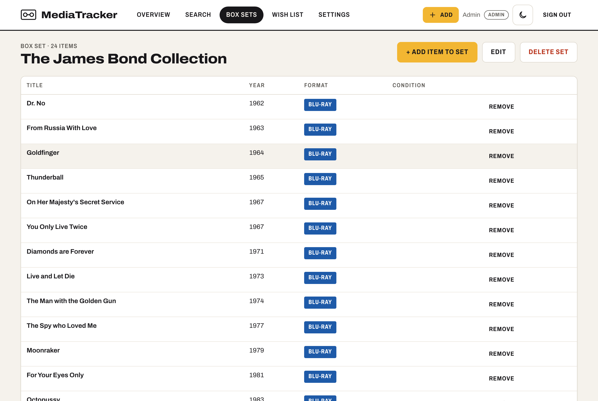
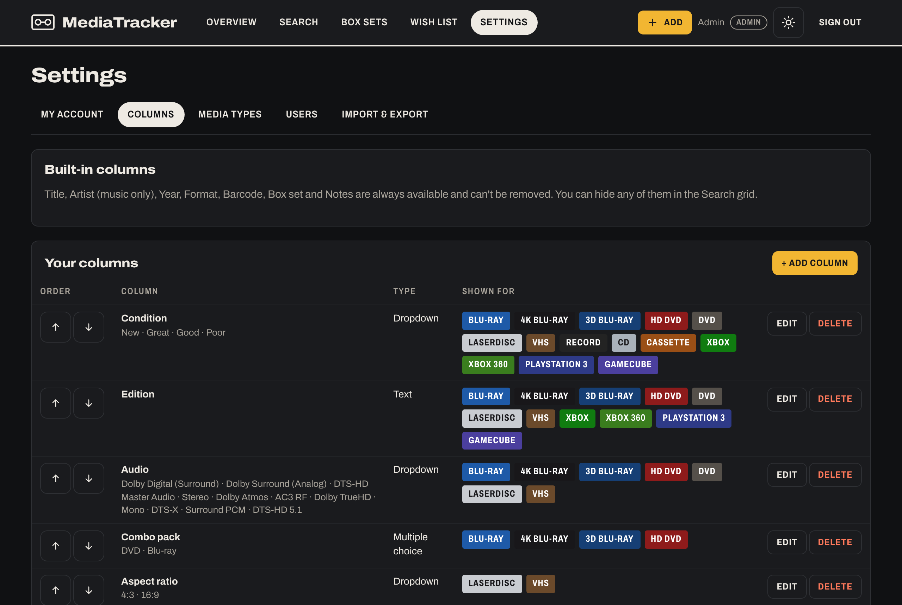

# MediaTracker

A self-hosted app for tracking a physical media collection — VHS, Laserdisc, Blu-ray, 4K, records, CDs, cassettes, video games — built for one job above all: **standing in a thrift store and finding out in two seconds whether you already own something.**

- **"Do I already own it?" search** by title, artist or barcode, with a camera barcode scanner on your phone. Results are grouped by title, so you see every format you own at once (GoldenEye → Blu-ray in the Bond box set, Laserdisc).
- **Barcode lookup** when adding items: the title, artist, original year and more are filled in from MusicBrainz, Discogs, UPCitemdb and TMDB. Optional free keys are managed in the app.
- **Configurable grid** with sortable, show/hide columns. Columns only appear for the formats they apply to (Max players for games, Aspect ratio for Laserdisc/VHS…).
- **Your own columns**: add, rename, reorder or delete columns, and edit dropdown options (e.g. Condition) — all in the app.
- **Media types** (formats and categories) managed in the app, each with its case colour. A format can serve several categories (Blu-ray for Movies and TV).
- **Plex sync**: your Plex movies and TV seasons are kept as Digital copies, linked to the discs you own, and updated hourly.
- **Box sets**: each film stays searchable on its own and links to the set; the set page lists everything in it.
- **Overview** dashboard, **wish list** (a simple to-do list), **trash** with 30-day restore.
- **Export** to CSV or a print-ready Excel workbook (one sheet per format).
- **Jira import** for the existing collection, with automatic clean-up (see [docs/IMPORT.md](docs/IMPORT.md)).
- **Sign-in** with Admin / Editor / Viewer roles. Light and dark mode. Installable on a phone as an app (PWA).

## Screenshots

These show the real app, run against an imported collection of about 2,300 items.



| At the store: "do I own it?" | Every format you own | Not in the collection |
|---|---|---|
|  |  |  |

**Grid view** (dark mode), filtered to Laserdisc, showing only the columns that apply to it:



**Adding an item:** the title box suggests what you already own, so the new copy links to it:



| Box sets | Your own columns |
|---|---|
|  |  |

## Running it

You need Docker, plus a reverse proxy that serves the app over **HTTPS**. Browsers only allow the camera and "install as app" on HTTPS.

The app listens on port **8080**. Set `MT_PORT` to publish it on a different host port.

**Dockhand (deploy from Git):**
1. Create a stack from the Git repository `https://github.com/duffduff99/MediaTracker.git`, branch `main`, compose file `docker-compose.yml`.
2. Optionally set the stack variables `TZ`, `MT_PORT` and `MT_DATA`.
3. Deploy.

**Plain Docker:**

```bash
git clone https://github.com/duffduff99/MediaTracker.git && cd MediaTracker
docker compose up -d
```

On first start, the container log prints the generated **admin password**. Sign in as `admin` and change it under **Settings → My account**.

Full setup, updating, backups and troubleshooting are in **[docs/MAINTENANCE.md](docs/MAINTENANCE.md)**.

## Documentation

| | |
|---|---|
| [docs/MAINTENANCE.md](docs/MAINTENANCE.md) | Install, update, back up, restore, troubleshoot — what you need to run it long-term |
| [docs/SPEC.md](docs/SPEC.md) | What the app does and the decisions behind it |
| [docs/IMPORT.md](docs/IMPORT.md) | Importing from Jira and what the import cleans up |
| [docs/DEVELOPMENT.md](docs/DEVELOPMENT.md) | Code layout and how to run it locally, if you ever want to change something |

## Tech

One container: a Python ([FastAPI](https://fastapi.tiangolo.com/)) API that also serves a React front end. Data lives in a single SQLite file in the `/data` volume, with automatic nightly backups beside it. No separate database server.
